# BillAlert

Electricity billing notifications for **Barangay Tubod, Clarin, Bohol**, served
by Bohol I Electric Cooperative across four service areas.

CS 312 Mobile Application Development · Bohol Island State University
Team: Carcallas (Admin, lead) · Busalanan (Meter Reader) · Obiso (Cashier) ·
Basio (Consumer)

BillAlert brings meter readings, cooperative bill amounts, cash collections,
receipts, and household alerts into one role-based Flutter application.
Android is the supported platform; the web build is available for development
and screen previews.

## Features by role

| Role | Main screens | Purpose |
|---|---|---|
| Admin / Area President | Amounts, Notices, Accounts, Profile | Post cooperative-provided amounts, manage disconnection notices, and create staff and household accounts within the assigned area. |
| Meter Reader | Readings, Consumers, Remit, Profile | Browse the household roster, enter meter readings, view reading sheets, and review remittance information. |
| Cashier | Consumers, Receipts, Remit, Profile | Find a household, record a cash payment, review receipts, and record remittance handovers. |
| Consumer | Bill, History, Inbox, Profile | View the current bill, previous bills and receipts, and billing notifications. |

These screens are implemented in the current source. Availability of data,
account-management actions, and SMS delivery depends on the configured backend.
See [backend setup](supabase/README.md) for the migration order and Edge Functions.

---

## App previews

Mobile-sized captures (390 × 844 CSS viewport @ 2× scale, 780 × 1688 px resolution) taken from the web build in Microsoft Edge. Sensitive personal data, account numbers, meter IDs, receipt identifiers, and financial amounts are solidly masked with opaque overlays for privacy.

> [!NOTE]
> Web previews demonstrate responsive mobile UI layouts and navigation. Platform-specific security features — such as biometric fingerprint authentication and SQLCipher hardware keystore encryption — run exclusively on Android hardware.

### Sign-in

| Sign-in screen |
| :---: |
| 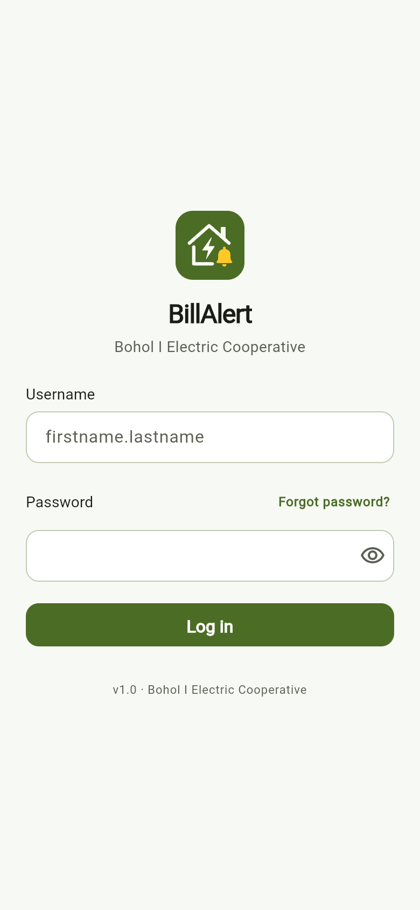<br><sub>_Role-agnostic authentication with automatic `@billalert.local` domain resolution_</sub> |

### Admin / Area President

| Post bill amount | Disconnection notices | Account management |
| :---: | :---: | :---: |
| 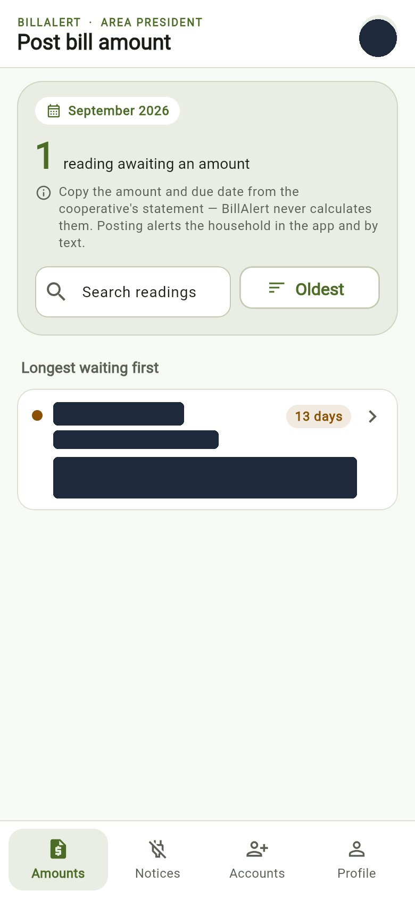<br><sub>_Post cooperative-provided amounts_</sub> | 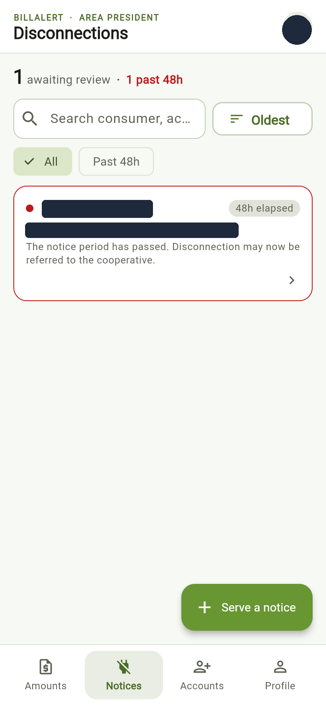<br><sub>_Review overdue disconnection notices_</sub> | 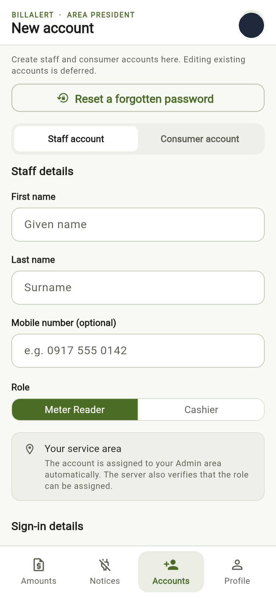<br><sub>_Create staff and consumer accounts_</sub> |

### Meter Reader

| Readings & route progress | Household roster |
| :---: | :---: |
| 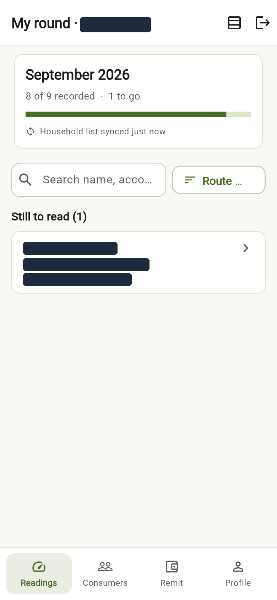<br><sub>_Monthly cycle reading tracker & queue_</sub> | 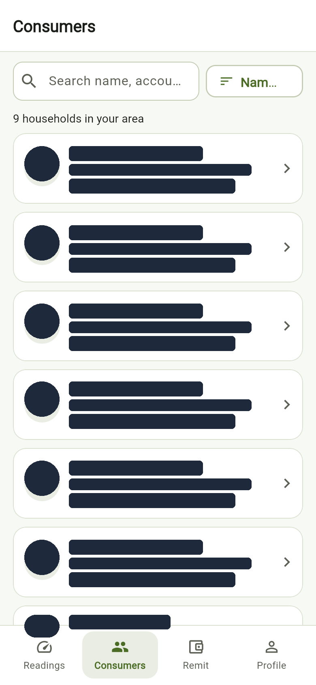<br><sub>_Assigned area household directory_</sub> |

### Cashier

| Payable consumer bills | Receipts & collection ledger |
| :---: | :---: |
| 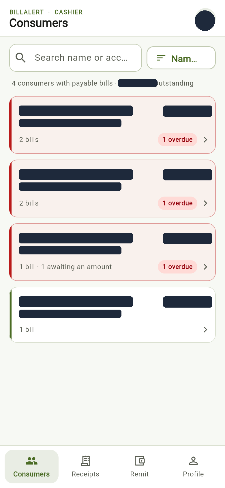<br><sub>_Outstanding consumer balance directory_</sub> | 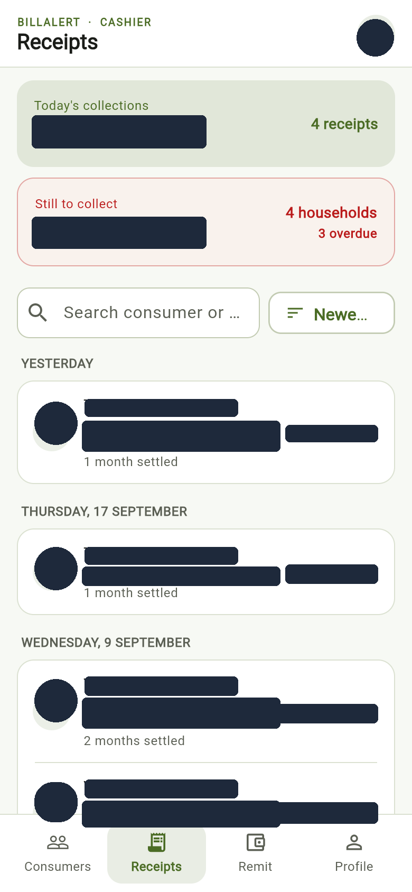<br><sub>_Recorded payment receipts and daily totals_</sub> |

### Consumer

| Current bill status | Billing & payment history | Alerts & notification inbox |
| :---: | :---: | :---: |
| 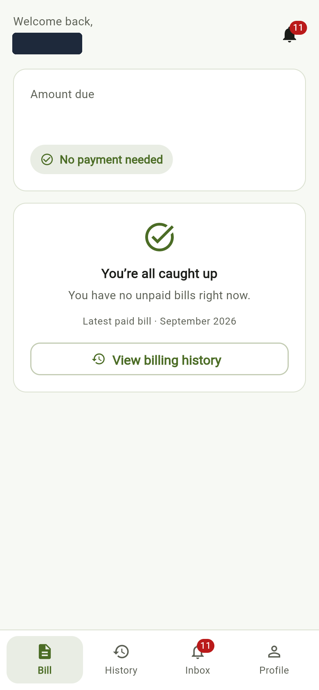<br><sub>_Bill status and payment breakdown_</sub> | 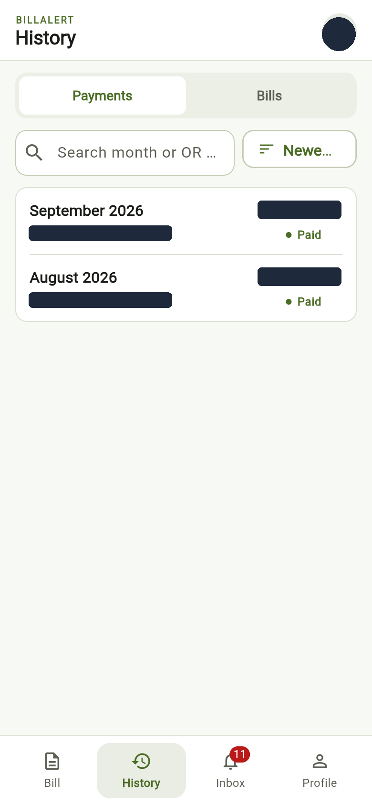<br><sub>_Settled receipts & invoice archive_</sub> | 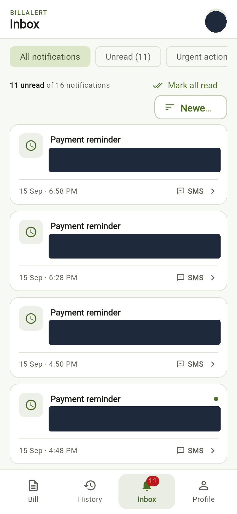<br><sub>_SMS bill notices & payment reminders_</sub> |

---

## The one rule to read before anything else

**BillAlert never derives a bill amount from consumption.** The Admin enters
the cooperative's figure, and any centavos are always rounded up to the next
whole peso before posting.

The meter reader captures a reading, which creates a bill in an **unpriced**
state — consumption recorded, no amount, no due date. About seven days later
the cooperative returns a peso figure and the Area President posts it, which
makes the bill payable and sends the consumer's bill-ready notification.

There is no tariff or rate table. Apart from the whole-peso ceiling, the app
does not calculate money. If you find yourself writing a multiplication from
kWh that produces pesos, stop and ask — you have misunderstood the domain.

---

## Setup from a clean clone

### 1. Prerequisites

| Tool | Version used |
|---|---|
| Flutter | 3.44.0 (stable) |
| Dart | 3.12.0 |
| Android SDK | **compileSdk 36**, minSdk 24 |

`compileSdk` is pinned to 36 in `android/app/build.gradle.kts`, which is also
Flutter 3.44's default — pinned so a Flutter upgrade cannot move it silently.

**Do not raise it to 37.** `flutter_secure_storage` 11 requires 37, which is
why this project holds that dependency at **10.3.1**. The only API 37 the SDK
manager publishes is the preview `android-37.0`; Gradle asks for a plain
`android-37`, which does not exist, so there is nothing to install and the
build cannot be fixed by installing anything. Check that `android-37` is real
before anyone tries again:

```bash
sdkmanager --list | grep "platforms;android-37"
```

**Android is the product.** The web build below runs, but only as a
development convenience. The `ios/` and `windows/` folders are as
`flutter create` left them and are not configured.

### Running in a browser

```bash
flutter run -d edge --dart-define=SUPABASE_URL=https://YOUR-PROJECT.supabase.co --dart-define=SUPABASE_ANON_KEY=YOUR-ANON-KEY
```

On Windows, this opens Microsoft Edge. Use `-d chrome` for Chrome instead.
For portrait phone previews in Edge, open Developer Tools, enable the device
toolbar, and select a responsive viewport of **390 × 844 CSS pixels** at 100%
page zoom. Browser previews do not verify Android-specific functionality.

Useful when you want to iterate on a screen without waiting for the emulator.
Two things are committed under `web/` to make it work, and both must stay:
`sqlite3.wasm` (SQLite compiled to WebAssembly) and `drift_worker.js` (copied
from the installed drift package, so it cannot fall out of step with the
version in `pubspec.lock` — re-copy it if you ever change the drift version).

**The cache is not encrypted in a browser, and cannot honestly be made so.**
SYS-05 is satisfied on Android by SQLCipher plus a key in the Android
Keystore. Neither half survives the move to the web: drift opens the database
inside a web worker, where the `localSetup` callback that would run
`PRAGMA key` is documented as not being called, and the key would sit in
browser storage where any script or open devtools panel could read it. The
code says so out loud — `databaseIsEncrypted` is `false` in
`lib/data/local/connection/web_connection.dart`.

So: build screens on the web if it is faster. Do not sign in as a real
consumer there, and do not use a web build as evidence to anyone that the
cache is encrypted. Demo on Android.

```bash
flutter --version    # expect 3.44.x
flutter doctor       # Android toolchain must be green
```

### 2. Install dependencies and generate code

```bash
flutter pub get
```

```bash
dart run build_runner build
```

The second command generates `lib/data/local/app_database.g.dart` from the
Drift table definitions.

That file **is** committed, so a fresh clone needs no code-generation step and CI needs no
codegen step. The cost is that it is 200 KB of generated code in your diffs:
whenever you change `lib/data/local/tables.dart`, re-run `build_runner` and
commit the regenerated file in the same commit, or the next person's build
will disagree with the schema. If two people change `tables.dart` at once,
resolve the conflict by re-running `build_runner` rather than by hand-merging
the generated file.

### 3. Supply the Supabase settings

The app reads its backend settings from `--dart-define` compile-time variables,
through the single `AppConfig` class in `lib/core/config/app_config.dart`.

Keep backend configuration and account credentials out of tracked files.
`.gitignore` excludes `.env`, `env.json`, `dart_define.json`, and local
`run_local.ps1` / `run_local.sh` files.

| Variable | Required | What it is |
|---|---|---|
| `SUPABASE_URL` | yes | `https://<project>.supabase.co` |
| `SUPABASE_ANON_KEY` | yes | the project's anon / publishable key |
| `LOGIN_EMAIL_DOMAIN` | no | defaults to `billalert.local` |

For a new backend, follow [the Supabase setup guide](supabase/README.md),
including its explicit migration order, authentication profiles, and required
Edge Functions. An existing configured backend does not need to be recreated.
Never use a Supabase service-role key in the Flutter application.

Alternatively, put the two required settings in a local, ignored `env.json`:

```json
{
  "SUPABASE_URL": "https://YOUR-PROJECT.supabase.co",
  "SUPABASE_ANON_KEY": "YOUR-ANON-KEY"
}
```

Then run the browser preview:

```bash
flutter run -d edge --web-port=5187 --dart-define-from-file=env.json
```

Run it:

```bash
flutter run --dart-define=SUPABASE_URL=https://YOUR-PROJECT.supabase.co --dart-define=SUPABASE_ANON_KEY=YOUR-ANON-KEY
```

Build a debug APK:

```bash
flutter build apk --debug --dart-define=SUPABASE_URL=https://YOUR-PROJECT.supabase.co --dart-define=SUPABASE_ANON_KEY=YOUR-ANON-KEY
```

Building without them is not a crash: the app shows a screen naming the two
flags it is missing.

Two templates are provided so nobody has to retype the flags:

```bash
cp .vscode/launch.json.example .vscode/launch.json
```

```bash
cp run_local.example.ps1 run_local.ps1
```

Fill in your own values. Both destinations are gitignored — `.vscode/launch.json`
is where an anon key most easily gets committed by accident. **In Android
Studio**, use Run → Edit Configurations → Additional run args instead.

### 4. Sign in

Supabase Auth signs in with an email, but the login screen asks for a username,
which is what staff are given. The app appends `@billalert.local`:

```
username  demo.reader
sends     demo.reader@billalert.local
```

This is an illustrative username, not a supplied login. Obtain an account
privately from the project administrator. Enter only the username before `@`
and your password; credentials are intentionally not published in this README.

So every account in Supabase Auth must be created with that synthetic email,
and `profiles.username` must match the part before the `@`. Bridging the two is
done in `AuthRepositoryImpl` and nowhere else, so switching to mobile-number
login later is a one-file change.

---

## Running the tests

```bash
flutter test
```

The automated suite includes domain, repository, architecture, and widget
tests. Examples of its coverage:

| File | What it pins down |
|---|---|
| `test/domain/money_test.dart` | Money arithmetic, including adding 0.10 ten times, with the failing `double` version asserted beside it |
| `test/domain/bill_test.dart` | unpriced / payable / partial / settled / overdue |
| `test/usecases/record_meter_reading_test.dart` | the reading flow against hand-written fakes — proof the domain needs no network |
| `test/architecture/domain_has_no_dependencies_test.dart` | `domain/` imports nothing; no field named like an amount is a `double` |
| `test/data/encryption_test.dart` | the database file on disk is not plaintext, and a wrong key cannot read it |

Static analysis must be clean:

```bash
flutter analyze
```

`flutter_lints` plus `prefer_final_locals` and `always_declare_return_types`,
which the brief requires. Zero warnings is the standard, not a target.

---

## Implementation and platform limits

### Built — the meter reader's flow, end to end

Sign in → roster (from the encrypted cache, works offline) → reading entry →
outbox write → sync → `fn_record_meter_reading` → an unpriced bill on the
server.

The Admin, Cashier, and Consumer sections also have implemented screens and
repository integrations. Role routing is defined in
[router.dart](lib/presentation/router.dart), with permitted tabs defined by
[AppUser](lib/domain/entities/app_user.dart). Supabase Row-Level Security
enforces access to backend records.

- Existing-account editing is deferred; the Accounts screen provides account
  creation and forgotten-password recovery.
- Native phone notifications, fingerprint sign-in, and Android cache encryption
  must be tested on Android. Edge screenshots only document the visible UI.
- SMS delivery requires the server functions, scheduler, and gateway described
  in [the backend guide](supabase/README.md).
- iOS and Windows desktop targets are not configured product releases.

---

## Project layout

```
lib/
  core/          Result, AppFailure, AppConfig        pure Dart
  domain/        entities, value objects, use cases,  pure Dart, imports nothing
                 abstract repositories
  data/          repository implementations, DTOs,    Supabase, Drift, SQLCipher
                 the sync engine
  presentation/  screens, view models, routing        Flutter, Riverpod, go_router
```

`ARCHITECTURE.md` explains the dependency rule, where a new feature goes, and
why money is not a double. Five minutes, and it is worth them.

---

## House rules

These are short so you will actually remember them.

- **Money is never a `double`.** Use `Money`, which holds centavos as an `int`.
- **Never compute a bill amount.** Anywhere.
- **Screens never talk to Supabase.** Screen → view model → use case →
  repository. If a widget file imports `supabase_flutter`, the layering is
  broken.
- **Never reimplement a Postgres function in Dart.** `fn_record_payment`
  settles several bills atomically; a Dart loop is not the same thing.
- **Every mutation goes through the outbox first.** Even on wifi at your desk.
  The offline path must be the only path or it will be broken by Week 14 and
  nobody will notice until the demo.
- **Errors get plain-English messages.** Map them in `FailureMapper`, which is
  the only file allowed to know what a `PostgrestException` is.
- **Ask before changing the database.** Charles changes the schema and re-runs
  the tests.
- **Commit daily, in your own name.**

---

## Two things the team must decide

Both are marked in the code where they matter.

1. **`local_cache_schema.sql` stores money and readings as `real`** — a double.
   The Drift port uses INTEGER centavos and hundredths instead, because the
   money rule wins. The SQL file should be updated to match.
2. **`v_local_reading_progress` uses the phone's local time** to work out the
   current cycle, which can disagree with the server's Philippine date. The app
   computes the cycle in Dart from `PhDate` instead and does not use the view.

---

## Dependency note

`sqlcipher_flutter_libs` is deprecated — version 0.7.0 contains no code. This
project gets SQLCipher by selecting it in `pubspec.yaml`:

```yaml
hooks:
  user_defines:
    sqlite3:
      source: sqlcipher
```

Verified in this project as SQLCipher 4.18.0 community. Removing that block
makes the app silently write an unencrypted database, which is why
`test/data/encryption_test.dart` exists.

---

## AI assistance

The initial scaffold in this repository — the layer structure, the shared
kernel, the offline outbox and the meter reader flow — was generated with
Claude Code (Claude Opus 5) from a written specification, then reviewed. This
is declared in the Technical Documentation as the syllabus requires.

The syllabus also prohibits submitting generated code you cannot explain. Read
`ARCHITECTURE.md`, then read `Money`, `Bill`, `Result`, `OutboxOperation` and
`RecordMeterReading` line by line before Week 11 starts. If you cannot explain
why `OutboxOperation` is sealed or where the app decides a bill is unpriced,
you are not ready for the oral examination.
